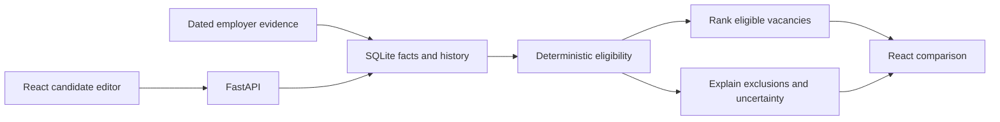

# Architecture and API

## Database

The `candidate` row stores typed profile JSON and an optimistic version. `vacancy` holds an immutable typed seed snapshot keyed by (dataset, id). `verification` records source, result, timestamp, authority and evidence. The unique identity of an observation makes retries idempotent. An index on (dataset, vacancy_id, observed_at) supports replay. Reads select facts and events in one transaction. Source observations only affect snapshots on or after their observation date.

## API

| Method and path | Contract |
|---|---|
| GET /api/profile | Returns `{version,profile}`. Add `include_mode=true` for the current persistence mode. |
| PUT /api/profile | Requires current version and typed profile. Stale version returns 409. Invalid inputs return 422. |
| POST /api/match | Takes `{k,as_of,freshness_days,dataset}`. Returns baseline, eligible shortlist, decision groups, evidence, duplicate flags and profile version. |
| POST /api/profile/preview | Validates a candidate profile and returns it without persistence. |
| POST /api/match/preview | Runs the requested dataset using the validated profile supplied in the request. |
| POST /api/match/demo | Uses the same query and engine with the seed profile for reproducible walkthroughs. Returns `profile_version: null` and does not write a profile. |
| POST /api/vacancies/{dataset}/{vacancy_id}/observations | Appends a typed timestamped evidence event with `{result,source,note,observed_at,authoritative}`. Returns current status, history and optional retry timing. Unknown ID returns 404. |

## Algorithm

1. Closure takes precedence. Treat unknown, conflicting or stale status as needing confirmation.
2. Check location or remote scope, allowed employment type, date-window overlap, duration and known end date. Evaluate listed degree, academic stage, graduation year, experience and mandatory skills against the candidate profile. If any hard check fails, exclude the job. Route unresolved evidence to Needs confirmation.
3. Use employer + provider + requisition ID for exact grouping. In the shortlist collapse exact duplicates, and suppress promotion if alias decisions disagree. Probable pairs use employer aliases and same-city title similarity or audit tags. Keep probable pairs visible for review.
4. Rank eligible results by TF-IDF cosine across normalized role-family and title terms (60%), skill overlap (25%), city, work mode and stipend preferences (2.5% each), and freshness (7.5%). The baseline uses the same score across all inputs. This local implementation shares the TF-IDF fit across both comparisons for a controlled experiment.
5. Save status observations and use the newest authoritative result. Simultaneous disagreement becomes conflict. Failure events retain prior evidence, do not set closed and schedule a 30 second exponential retry capped at one hour. This service records and schedules. It has no live ATS worker.

## Production integration

Give evidence spans stable IDs and separate hard facts from suggested preferences. Add authenticated per-user storage, employer-specific adapters with bounded concurrency and permitted source access, retry jitter, verification TTLs by provider, idempotent job queues and event-driven cache invalidation. Phone testing and production observation races require staging. The editable API uses one shared profile. Public read-only mode compares the fixed fixture data and blocks both mutation endpoints. Production writes would require authentication and per-candidate isolation. The 31 rows are a small targeted sample with no independent complete set of eligible labels. Evidence coverage means each row has a traceable record, including inaccessible-source notes.
